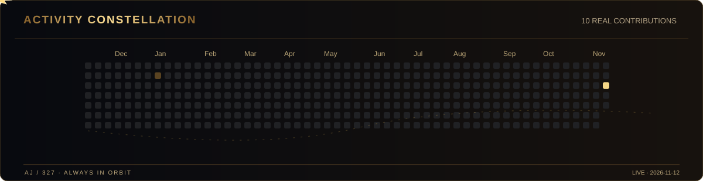

# ✦ ABRAHAM M. JOSEPH ✦

### FOUNDER  ·  BUILDER  ·  MUSIC-TECH

**Co-Founder & CEO of [BoomBox](https://github.com/BoomBoxOrg)**

*Building products that make culture feel closer.*

<a href="https://github.com/BoomBoxOrg"><b>BOOMBOX</b></a> &nbsp; · &nbsp; <a href="https://github.com/AJoseph327/flowstate-pomodoro-bmx"><b>FLOWSTATE</b></a> &nbsp; · &nbsp; <a href="https://www.linkedin.com/in/abraham-joseph-529652214/"><b>LINKEDIN</b></a>

---

### 01 // THE MISSION

I'm **Abraham M. Joseph**. I'm building **BoomBox**, a social music platform rooted in one idea: people connect through the music they love.

I care about the intersection of **product, culture, and community**—turning ambitious ideas into experiences people actually want to be part of.

> **Songs, not selfies.** The next wave of social connection starts with music.

### 02 // WHAT I'M BUILDING

| **BOOMBOX · MUSIC IS SOCIAL** | **FLOWSTATE · FOCUS LAB** |
| :--- | :--- |
| A community-first platform to discover people through music. | A focus and Pomodoro experience for people who want to get things done. |
| [Explore BoomBox](https://github.com/BoomBoxOrg) | [Explore Flowstate](https://github.com/AJoseph327/flowstate-pomodoro-bmx) |

### 03 // ACTIVITY CONSTELLATION

  
  Real GitHub contribution data · Daily refresh from a free, self-hosted GitHub Action · No fake commits.

### 04 // HOW I BUILD

`PRODUCT STRATEGY` &nbsp; ✦ &nbsp; `MUSIC + CULTURE` &nbsp; ✦ &nbsp; `TEAM LEADERSHIP` &nbsp; ✦ &nbsp; `SHIP > HYPE`

I believe a great product should be more than impressive technology. It should make someone feel something.

---

**IDEAS → EXPERIENCES → IMPACT**

AJ / 327 · Original black-and-gold artwork · $0 paid tools

